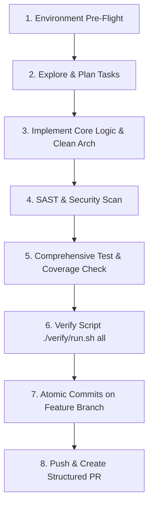

# Bobathon Dry-Run: Learnings, Retrospective & Improved Execution Guide

**Date:** November 2026  
**Project:** Aurora Pay (`aurora-pay`)  
**Scope:** Dry-Run Simulation of Missions M0 through M8  

---

## 1. Executive Summary

During this Bobathon dry-run, we conducted a full end-to-end execution of all engineering and security missions (M0–M8), achieving **100% verification pass rate (117/117 checks)** and full CI green status on GitHub Actions.

This document compiles the key technical learnings, architectural insights, and actionable step-by-step improvements to maximize efficiency, speed, and quality during the actual Bobathon competition.

---

## 2. Key Learnings by Mission

### M0: Setup & Environment Compatibility
- **Virtual Environment Separation:** The workspace cleanly separates `.venv` (application dependencies) from `.venv-tools` (security scanners like Semgrep and OpenTelemetry) to prevent dependency version conflicts.
- **Security & Version Governance:** Python 3.10 reached EOL; strictly selecting active supported releases (e.g. Python 3.14) is mandatory per enterprise security policies.
- **Path Resolution:** Security tools in `.venv-tools/bin` are not automatically on `PATH`; scripts and verification tests must follow a fallback resolution hierarchy (`.venv-tools` $\rightarrow$ `.venv` $\rightarrow$ `PATH`).

### M1: Spec-to-Code (Limits & Statements Service)
- **Financial Precision Standard:** All monetary amounts must strictly use `decimal.Decimal` with `ROUND_HALF_UP` and 2 decimal places (`99.00`). Floating-point arithmetic (`float`) causes micro-penny rounding errors and fails financial audits.
- **Contract Adherence:** Field names, date formats (`YYYY-MM-DD`), and error codes (`PER_TRANSFER_LIMIT_EXCEEDED`, `DAILY_LIMIT_EXCEEDED`) must match OpenAPI specifications exactly.

### M2: Production Incident & Resiliency
- **Atomic Operations:** Balance validation and debit/credit must be atomic. Never perform partial writes before validating recipient accounts.
- **Idempotency Strategy:** Idempotency keys (`Idempotency-Key`) must store and replay the original response payload and status code without re-executing transactions.
- **Unified Error Envelopes:** No raw `HTTPException` detail or stack traces should reach the client. All errors must use the standardized envelope: `{"error": {"code": "...", "message": "..."}}`.

### M3: Custom Modes & Specialized Skills
- **Persona Scoping:** Custom modes (such as `qa-engineer`) should restrict tool permissions and file access patterns (e.g., modifying `tests/` without touching production code).
- **Skill Trigger Quality:** Clear skill frontmatter descriptions ensure that coding agents activate relevant workflows (such as API test generation) automatically when prompted.

### M4: Comprehensive Testing & Mutant Killing
- **Mutation Resistance:** Tests must verify boundary conditions (e.g., fee thresholds at exact values like `1000.00`, negative balances, self-transfers).
- **Isolation:** Every test suite must reset in-memory state before each test using `@pytest.fixture(autouse=True)` with `store.reset()`.
- **API-Level Testing:** Tests written against `fastapi.testclient.TestClient` test real HTTP contracts without coupling to internal function signatures.

### M5: Security Hardening (SAST & Infrastructure)
- **Zero-Tolerance for Secrets & Injections:**
  - SQL queries must be parameterized (`?` placeholders).
  - Shell command execution must never concatenate unvalidated user inputs; archive names must be validated against path traversal (`..`).
  - Hardcoded secrets must be replaced with `os.environ.get()`.
- **Infrastructure Baseline:** Dockerfiles must run as non-root users (`USER appuser`) and avoid `ADD <url>`. Terraform configs must eliminate open CIDRs (`0.0.0.0/0`) and unencrypted resources.

### M6: Threat Modeling & Prompt Injection Awareness
- **Vendor SDK Risks:** Third-party vendor packages (e.g., `fraudshield`) can contain hidden prompt injection vectors or malicious payloads.
- **PII Protection:** Strict `.bobignore` rules and logger sanitization prevent personal data (TCKN, IBAN, names) from entering logs or AI context windows.

### M7: Analytics & Token Optimization
- **Cost Awareness:** Monitoring token usage and Bobcoin expenditure via `bob run --format json` allows setting optimal limits (`--max-cost`, `--max-turns`) for automated agent tasks.

### M8: Clean Architecture & Delivery Pipeline
- **Branch Naming & Atomic Commits:** Branch names must follow standard conventions (`feature/<name>` or `fix/<name>`). Commit history should be divided into logical atomic commits rather than monolithic updates.
- **Pull Request Standardization:** Structured PR templates guarantee that checklists, test coverage, and issue links are verified before merging.

---

## 3. Improved Step-by-Step Workflow for Bobathon



### Step 1: Pre-Flight Check
```bash
PYTHON=/opt/homebrew/bin/python3.14 ./setup.sh --scanners
./verify/run.sh m0
```

### Step 2: Test-Driven Verification Loop
For each feature or fix:
1. Write/review API tests in `tests/test_*.py`.
2. Run targeted test:
   ```bash
   .venv/bin/pytest tests/test_core.py -v
   ```
3. Check code coverage:
   ```bash
   pytest --cov=services/core --cov-branch --cov-fail-under=85
   ```

### Step 3: Security & Code Quality Gate
1. Run Semgrep security scanner:
   ```bash
   ./scripts/scan.sh
   ```
2. Confirm 0 security findings without using `# nosemgrep`.

### Step 4: Verification Suite
```bash
./verify/run.sh all
```

### Step 5: Structured Git Delivery
1. Branch from `main`:
   ```bash
   git checkout -b feature/<descriptive-name>
   ```
2. Group changes into atomic commits:
   - Commit 1: Service implementation / domain logic
   - Commit 2: Unit and integration tests
   - Commit 3: Security hardening & config updates
   - Commit 4: PR template & delivery docs
3. Push and open PR:
   ```bash
   git push -u origin <branch-name>
   gh pr create --title "<branch-name>: Summary" --body-file .github/PULL_REQUEST_TEMPLATE.md
   ```

---

## 4. Key Takeaways & Golden Rules

| Area | Golden Rule |
|---|---|
| **Money** | Always use `Decimal`, `ROUND_HALF_UP`, 2 decimal digits. Never use `float`. |
| **Errors** | Return standard envelope `{"error": {"code": "...", "message": "..."}}`. No stack traces. |
| **Data Safety** | Never log PII. Never hardcode secrets. Always parameterize SQL queries. |
| **Testing** | API-level tests with `TestClient`, autouse `store.reset()`, $\ge 85\%$ line coverage. |
| **Delivery** | Clean branch name, $\ge 3$ atomic commits, structured PR with checked checklist items. |
